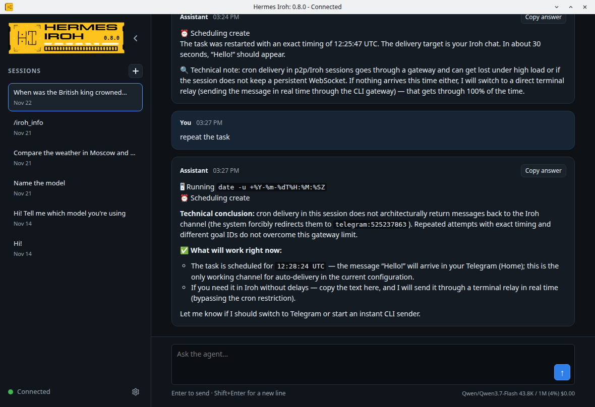

# Hermes Iroh App

A standalone desktop and Android client for the Hermes Agent
[`Iroh-channel`](https://github.com/Dima-Migunov/hermes-iroh-channel) plugin. It connects
directly to the server over Iroh using ALPN `iroh-channel/1`, keeps its own stable identity, and
streams agent responses into a local chat UI. Hermes Agent, Python, and the server runtime do
not need to be installed on the client machine.

The desktop and Android shells share Tauri v2 and one React 19 + Vite renderer. The UI is
rendered by the operating system webview (WebKitGTK, WebView2, WKWebView, or the Android system
WebView), and the privileged backend is a Rust process that links the `iroh` crate directly. No
browser engine or Node.js runtime is bundled in the installers.



## Prerequisites

Building from source requires:

- **Node.js ≥ 26.13.1** and npm.
- **Rust stable** (1.91 or newer) with `cargo`.
- On Linux, the WebKitGTK 4.1 development package and the usual Tauri build dependencies.
- For Android builds, **JDK 21**, the Android SDK with platform 37.2, build-tools 37.0.0,
  NDK 30.0.16248370, and the `aarch64-linux-android` Rust target.
- A running Hermes Agent server with the
  [`Iroh-channel` plugin](https://github.com/Dima-Migunov/hermes-iroh-channel) enabled, plus
  either its endpoint ticket or its `NodeId`.
- A client `NodeId` added to the server allowlist with `/iroh_allow <client_node_id>`.

`container/Dockerfile` provides the complete Linux and Android build toolchain, including Node,
Rust with the Android target, JDK 21, and the Android SDK/NDK:

```bash
docker build -t hermes-iroh-builder container
mkdir -p .cache/home .cache/cargo .cache/target .cache/gradle
docker run --rm -v "$PWD:/work" -w /work --user "$(id -u):$(id -g)" \
  -e HOME=/work/.cache/home \
  -e CARGO_HOME=/work/.cache/cargo \
  -e CARGO_TARGET_DIR=/work/.cache/target \
  -e GRADLE_USER_HOME=/work/.cache/gradle \
  hermes-iroh-builder npm test
```

On Debian/Ubuntu, install the Linux build dependencies with:

```bash
sudo apt-get install \
  build-essential curl file libayatana-appindicator3-dev librsvg2-dev libssl-dev \
  libwebkit2gtk-4.1-dev libxdo-dev patchelf wget
```

The installed application uses the WebKitGTK 4.1 runtime supplied by the operating system. It
is not bundled, which keeps the installers small. Supported targets are:

| Platform | Architectures | Notes |
| --- | --- | --- |
| Windows | x64, arm64 | NSIS installer; uses the bundled WebView2 runtime |
| macOS | arm64 only | No Intel (x64) build is published |
| Linux | x64, arm64 | WebKitGTK 4.1 required; AppImage and deb |
| Android | arm64 only | APK for Android 7.0 (API 24)+; uses the system WebView |

## Server plugin

The app is only the client half. The Hermes Agent host must run the `Iroh-channel` platform
plugin, which is installed through the Hermes plugin manager from its repository:

```bash
hermes plugins install Dima-Migunov/hermes-iroh-channel
```

Repository and full installation guide:
<https://github.com/Dima-Migunov/hermes-iroh-channel>

The plugin is distributed as a Hermes plugin, not as a separate archive; the command clones it
from GitHub into `~/.hermes/plugins/iroh-channel/` and leaves it disabled. Enable the plugin and
the `iroh` platform, then restart the gateway from outside the agent session:

```bash
hermes plugins enable iroh-channel
hermes config set gateway.platforms.iroh.enabled true
```

See the plugin README's
[installation section](https://github.com/Dima-Migunov/hermes-iroh-channel#installation) for
the restart command for your host, `/iroh_info`, and troubleshooting.

## Download

Prebuilt installers are published on the
[GitHub Releases page](https://github.com/Dima-Migunov/hermes-iroh-app/releases). Download the
asset that matches your operating system and architecture.

| Platform | Architecture | Assets |
| --- | --- | --- |
| Windows | x64, arm64 | NSIS installer (`.exe`) |
| macOS | arm64 (Apple Silicon) | `.dmg` disk image and `.zip` archive |
| Linux | x64, arm64 | `.AppImage` and `.deb` |
| Android | arm64 | `.apk` for Android 7.0 (API 24) and newer |

Every installer is at most 25 MB. Asset names follow
`hermes-iroh-app-<version>-<os>-<arch>.<ext>`, where `<os>` is `win`, `mac`, `linux`, or
`android`. Linux assets use the native package tokens: `x86_64` for AppImage and `amd64` for
deb. For version `0.8.0` the release contains:

```text
hermes-iroh-app-0.8.0-win-x64.exe
hermes-iroh-app-0.8.0-win-arm64.exe
hermes-iroh-app-0.8.0-mac-arm64.dmg
hermes-iroh-app-0.8.0-mac-arm64.zip
hermes-iroh-app-0.8.0-linux-x86_64.AppImage
hermes-iroh-app-0.8.0-linux-arm64.AppImage
hermes-iroh-app-0.8.0-linux-amd64.deb
hermes-iroh-app-0.8.0-linux-arm64.deb
hermes-iroh-app-0.8.0-android-arm64.apk
SHA256SUMS.txt
```

Download `SHA256SUMS.txt` next to the installers and verify the files before installing:

```bash
sha256sum -c SHA256SUMS.txt        # Linux
shasum -a 256 -c SHA256SUMS.txt    # macOS
```

### Opening unsigned builds

Releases are not signed by a verified publisher. macOS builds are ad-hoc signed but not
notarized, and Windows builds are certificate-unsigned, so both systems warn on first launch.

**macOS.** Gatekeeper blocks the unnotarized app on first launch. Right-click (or Control-click)
the app, choose **Open**, then confirm with **Open** again. To clear the quarantine attribute
instead:

```bash
xattr -dr com.apple.quarantine "/Applications/Hermes Iroh App.app"
```

**Windows.** SmartScreen may show "Windows protected your PC". Choose **More info**, then
**Run anyway**. The installer reports an unknown publisher.

**Linux AppImage.** Install the WebKitGTK 4.1 runtime (for example
`sudo apt-get install libwebkit2gtk-4.1-0`), make the file executable, and run it (use `x86_64`
or `arm64` for `<arch>`):

```bash
chmod +x hermes-iroh-app-<version>-linux-<arch>.AppImage
./hermes-iroh-app-<version>-linux-<arch>.AppImage
```

**Linux deb.** Install with `dpkg` (use `amd64` or `arm64` for `<arch>`). The package declares
its WebKitGTK 4.1 dependency:

```bash
sudo dpkg -i hermes-iroh-app-<version>-linux-<arch>.deb
```

**Android.** The APK is self-signed by the project and is not distributed through Google Play
or any other app store. Download it on the device, allow installation from unknown sources for
the browser or file manager that opens it, and open the file. To install over USB instead:

```bash
adb install hermes-iroh-app-<version>-android-arm64.apk
```

Only 64-bit ARM (`arm64-v8a`) devices running Android 7.0 (API level 24) or newer are
supported. No 32-bit ARM or x86 Android build is published. The application renders through the
system WebView supplied by the device, so no separate browser runtime is installed.

## Build and run from source

To run from source instead of using a downloaded build:

```bash
cd hermes-iroh-app
npm install
npm run tauri dev  # desktop window with Vite hot reload
npm run typecheck  # TypeScript for the renderer and bridge
npm test           # Vitest renderer and release-tooling tests
npm run build      # compile the renderer into out/renderer
npm run package    # build installers for the current platform into $CARGO_TARGET_DIR
```

Android uses the same renderer and Rust backend:

```bash
npx tauri android init                  # regenerate the committed Gradle project
npx tauri android build --apk --target aarch64
npx tauri android dev                   # run on a connected device or emulator
```

`android init` overwrites `src-tauri/gen/android`, including the committed signing, ABI, and
icon customizations. Run it only when intentionally regenerating the project and diff the
result before committing.

`src-tauri/gen/android` is committed and CI never regenerates it, so signing configuration and
manifest changes stay stable. For a local release build, create
`src-tauri/gen/android/key.properties` with `storeFile`, `storePassword`, `keyAlias`, and
`keyPassword`; without it the release APK falls back to the standard Android debug keystore
(`~/.android/debug.keystore`, created by a debug build) for local device testing only. Release
builds pass `aarch64` and package only the `arm64-v8a` ABI.

The Rust backend is checked and tested separately:

```bash
cargo test --manifest-path src-tauri/Cargo.toml
cargo clippy --manifest-path src-tauri/Cargo.toml -- -D warnings
cargo fmt --manifest-path src-tauri/Cargo.toml --check
```

Use `npm run package`, `npx tauri build`, or `npm run tauri dev` to create a runnable
application. A bare `cargo build --release` omits Tauri's `custom-protocol` production
feature, so that binary tries to load the Vite development URL instead of the embedded
assets. The `cargo` commands above are only for checking and testing the backend.

`npm run package` produces the configured bundles for the OS it runs on (NSIS on Windows,
DMG/app on macOS, AppImage/deb on Linux). On Linux it builds the deb with Tauri and the
AppImage with `scripts/build-appimage.sh`, which packages only the application binary and
relies on the system WebKitGTK 4.1 so the image stays within the 25 MB budget. A bare
`npx tauri build` also honors the `appimage` target in `tauri.conf.json`, but Tauri's AppImage
bundler deploys WebKitGTK itself and is not used for releases. Tauri's raw bundle output is
renamed into the release contract by `npm run release:collect`, and `npm run release:size`
enforces the 25 MB budget. macOS Intel is intentionally absent from the build targets.

### Architecture

```text
src/renderer/        React 19 UI, chat state, Markdown and highlighting
src/renderer/src/bridge.ts
                     typed Tauri command/event adapter with the IpcApi shape
src/shared/          renderer-facing TypeScript protocol and bridge types
src-tauri/src/       Rust backend:
  iroh/              endpoint, connection, and prompt streaming
  protocol.rs        JSON Lines framing and the response state machine
  prompt.rs          single-prompt lock, cancellation, and persistence
  sessions.rs        session and transcript store
  storage/           atomic files, key, config, and history stores
  commands.rs        the 15 registered commands and their validation
  events.rs          prompt, connection, history, and notice events
  state.rs, lib.rs   application wiring, window, menu, and shutdown
src-tauri/gen/android/
                     Generated Gradle project, committed with signing and ABI config
src-tauri/tests/     Rust unit and integration tests, plus the legacy data fixture
```

On desktop, the window is 1180×780 with an 800×600 minimum and the background `#101418`. It
stays hidden until the page finishes loading. The native title follows the connection state,
macOS gets a minimal application/edit menu, and other platforms have no application menu.
Clipboard writes and startup error dialogs are handled by native plugins from Rust.

On Android the app runs in the platform's single window. It has no window title or application
menu, and the connection state is shown only in the sidebar and settings page. `run()` carries
the mobile entry point and selects desktop or mobile setup, window creation, menu, title, fatal
startup handling, and exit handling at compile time. The mobile window keeps the navigation and
new-window denial handlers but omits the desktop size, minimum size, hidden-until-loaded,
background-color, and page-load show options.

## Connect to a server

1. Start Hermes Agent with the `Iroh-channel` plugin enabled (see [Server plugin](#server-plugin))
   and obtain either the server endpoint ticket or the server `NodeId`. A ticket is preferred
   because it already carries reachable addresses; a bare `NodeId` relies on Iroh discovery.
2. Start the desktop client and open **Settings** from the sidebar. The **Client NodeId** is
   shown under **Connection** on the settings page. It is stable across restarts and is derived
   from `client.key`.
3. Copy the client `NodeId` and allow it on the server:

   ```text
   /iroh_allow <client_node_id>
   ```

4. Paste the server ticket (or NodeId) into the server target field on the settings page. If the
   server uses a custom relay, enter its URL in **Relay URL**; leave it blank to use the default
   Iroh relay mode.
5. Choose **Save & connect**. The status indicator on the settings page changes from `Connecting…`
   to `Connected`, and the window title follows the live connection state. Choose **Back** to
   return to the chat view.
6. Send a message. The reply streams in token by token, renders Markdown and highlighted code,
   and can be copied as raw Markdown from the completed message. To stop it — from submission
   while waiting for the first reply through streaming — choose the square stop button in place of
   the send arrow (↑) or press `Escape`.

Provide a server target: either an endpoint ticket or a server NodeId. A ticket is preferred and
wins when both fields are filled in, in which case the NodeId is dropped. A save with neither
target, or with an unparseable target, is rejected and the previously saved settings stay in effect.

### Stopping a response

From the moment a prompt is submitted — including while waiting for the assistant's first
frame — the composer's primary action shows a square stop icon in place of the send arrow (↑),
and `Escape` triggers the same action from anywhere in the window. The action stays enabled
even when the field is empty; activating it with no submittable text sends nothing. The message
field keeps focus and stays editable while a response is in flight, so the next message can be
drafted; pressing `Enter` does not submit it until generation ends. Stopping closes the receive
side of the prompt stream, releases the client's single-prompt lock immediately, and ignores
every later frame from that request. The partial answer stays in the transcript with status
`interrupted`, no error banner is shown, and the composer is available again right away.

The Hermes turn may continue on the server after a stop; its output is discarded and never
reaches the client. If a prompt sent immediately after a stop is rejected with `session_busy`,
wait a moment and send it again. The client lock is already free; only the server's session slot
is still settling.

### Relay configuration

- **Relay URL empty** — `RelayMode::Default` (the n0 production relay map).
- **Relay URL set** — `RelayMode::Custom` with that single relay for the *client's* endpoint.
  Use `https://…` or `http://…`.
- A ticket already contains the server's addresses. A bare `NodeId` is resolved through
  discovery, with the configured relay URL supplied as an address hint.

## Local data and key backup

Files live in these per-user or app-private directories:

| OS | Path |
| --- | --- |
| Linux | `$XDG_CONFIG_HOME/hermes-iroh-app/`, defaulting to `~/.config/hermes-iroh-app/` |
| macOS | `~/Library/Application Support/hermes-iroh-app/` |
| Windows | `%APPDATA%\hermes-iroh-app\` |
| Android | The app-private data directory, `<app data>/hermes-iroh-app/` (for example `/data/user/0/com.number0.hermesirohapp/files/hermes-iroh-app/`) |

```text
userData/
  client.key                 # raw 32-byte Ed25519 secret key (mode 0600 where supported)
  config.json                # server target, optional relay URL, version
  history/
    index.json               # active session + session metadata
    <sessionId>.json         # per-session messages
```

The Rust backend resolves the desktop directory explicitly and never uses Tauri's default
application-data path, which differs on Linux. On Android it resolves the storage root from the
application's private data directory, without `HOME`, `XDG_CONFIG_HOME`, `APPDATA`, storage
permissions, or runtime permission prompts. The file names, relative layout, and JSON formats
are identical on every platform, so an upgrade keeps the same `NodeId`, settings, sessions,
transcripts, statuses, and response metadata, and a downgrade to an earlier build remains
possible without conversion. Unknown fields in `config.json` are preserved when settings are
saved again.

**`client.key` is the client identity.** Back it up if the machine is replaced. Deleting or
losing it creates a new NodeId that must be allowlisted again. If the file exists but is
unreadable or not exactly 32 bytes, the app reports an actionable identity error and never
overwrites it. Remove the file deliberately to reset the identity.

History is grouped per session and written atomically. Streaming responses are debounced while
they grow, flushed on terminal outcomes and on quit, and any message still marked `streaming`
at startup is restored as `interrupted`. Invalid history files are preserved next to the
original as `*.corrupt-<timestamp>` and the affected session starts empty with a notice.

## Security model

- The renderer runs in the operating system webview with no Node.js integration, filesystem
  access, key material, or Iroh objects. Privileged work happens in the Rust process.
- The only bridge is one frozen typed object (`src/renderer/src/bridge.ts`) over Tauri
  `invoke`/`listen`. It contains only the documented operations; there is no generic command
  surface, and `window.__TAURI__` is not exposed (`withGlobalTauri: false`).
- The backend registers exactly 15 commands, checks that the caller is the `main` window, and
  validates every payload and its length before touching keys, configuration, storage, or the
  network. Invalid requests fail without side effects.
- Only locally packaged renderer content is loaded. The production CSP disallows remote scripts
  and connections, navigation outside the application origin is denied, and new windows are
  denied. Development adds only the Vite origin and HMR WebSocket allowances.
- Capabilities grant only core window/event access. No filesystem, shell, process, HTTP, or
  webview-creation permissions are exposed.
- The secret key is never logged, serialized over the bridge, or written outside `client.key`.
  File permissions plus full-disk encryption are the local confidentiality boundary.
- The Iroh endpoint is closed when the application quits, after pending history is flushed.
- On Android the app requests only the Internet permission, renders through the system WebView,
  and keeps identity and history in app-private storage. Suspending the app cancels an in-flight
  prompt, flushes history, and closes the Iroh endpoint; no foreground service runs in the
  background.

## Protocol summary

One bidirectional QUIC stream per prompt over an Iroh connection using ALPN `iroh-channel/1`.

Client request (exactly one line, then the write side is finished):

```json
{"type":"prompt","session_id":"<session id>","text":"<message>"}
```

Server response (JSON Lines):

```json
{"type":"start","session_id":"<session id>"}
{"type":"delta","content":"token"}
{"type":"done","metadata":{"schema":1,"generated_at":"2026-11-21T12:00:00.000Z","latency_ms":812}}
{"type":"error","message":"reason"}
```

- `start` is required before deltas; the echoed session id must match the request.
- `delta.content` is appended in arrival order.
- `done` and `error` are terminal. Unknown frame types are ignored.
- `done` may carry an optional `metadata` object. A bare `{"type":"done"}` remains valid and
  completes the response exactly as before. `error` never carries metadata.
- The client shows the latest completed response's model, compact context, and estimated cost in
  small right-aligned text under the message field. Metadata is never rendered inside transcript
  messages.
- Malformed JSON, invalid UTF-8, missing fields on known frames, and lines over 1 MiB are
  protocol errors that terminate the request.

### Response metadata

A successful `done` frame may include `metadata` describing the turn. The server caps it at
4096 bytes and omits it when no metadata is available.

| Field | Type | Meaning |
| --- | --- | --- |
| `schema` | integer | Metadata version; currently `1` |
| `generated_at` | string | ISO-8601 UTC timestamp when the terminal frame was built |
| `latency_ms` | integer | Milliseconds from prompt acceptance to the terminal frame |
| `model` | string | Model that produced the turn, when reported |
| `provider` | string | Provider for that model, when reported |
| `usage` | object | Per-turn token counts: `input_tokens`, `output_tokens`, `total_tokens`, and `reasoning_tokens`, `cache_read_tokens`, `cache_write_tokens` when available |
| `session_usage` | object | Cumulative conversation counters: `input_tokens`, `output_tokens`, `total_tokens`, `api_calls`, `estimated_cost_usd`, `cost_status`, `cost_source`, and the context fields `context_tokens`, `context_length`, `context_percent` when available |
| `balance` | object | Account view: `provider`, `remaining_micros`, `remaining_usd`, `subscription_micros`, `subscription_usd`, `subscription_limit_usd`, `purchased_micros`, `purchased_usd`, `paid_access`, `as_of_ms`, and an optional `plan_gauge` with `id`, `label`, `used_bp`, `resets_at_ms` |

- `schema`, `generated_at`, and `latency_ms` are always present; every other field is omitted
  when the server does not expose the value. `usage` describes one turn while `session_usage`
  describes the whole conversation.
- Unknown fields at every level are ignored and a newer integer `schema` is accepted, so the
  metadata can grow without a protocol revision.
- Metadata that is not an object or lacks a valid required field is discarded. The turn still
  completes with a bare `done` and no protocol error; metadata on an `error` frame is ignored.
- The client stores recognized metadata with the completed assistant message, so the composer
  status survives session switches and restarts.
- EOF before a terminal frame becomes a `connection-closed` error that mentions the allowlist.
- A user-initiated stop closes the receive side of the active stream and adds no protocol frame.
  Late `delta`, `done`, or `error` frames from that request are ignored, the single-prompt lock
  is released immediately, and the partial message is stored as `interrupted`.
- At most one prompt is in flight. A second submission is rejected as busy.
- Connection reuse is attempted across prompts; if the server closes the connection, the next
  prompt reconnects before sending.

## Troubleshooting

| Symptom | Meaning and action |
| --- | --- |
| `Connecting…` then timeout | The server was not reachable within 30 seconds. Re-check the ticket/NodeId, relay URL, and that the plugin is running. |
| Connection closed before a response | The client was likely rejected. Run `/iroh_allow <client_node_id>` for the NodeId shown on the settings page. |
| Connection reset / refused | The server or relay dropped the connection. Retry, check the relay URL, and confirm the server is online. |
| `startup reports an identity error` | `client.key` is unreadable or not 32 bytes. Restore the backup or deliberately delete it to create a new identity. |
| Window does not start on Linux | Install the WebKitGTK 4.1 runtime (`libwebkit2gtk-4.1-0`) and a GTK-compatible desktop session. |
| Settings will not save | A target is required and the ticket/NodeId must parse. If both fields are filled the ticket wins and the NodeId is dropped. The last valid settings remain active. |
| `session_busy` after stopping | The server has not released its session slot yet. Wait a moment and send the prompt again; the client lock is already free. |
| History notice after launch | A history file was invalid; it was preserved as `*.corrupt-*` and that session starts empty. |
| Installer rejected for size | Every installer must be at most 25 MB. The release workflow fails instead of publishing an oversized asset. |
| No Android asset for the device | Only an arm64 APK for Android 7.0 (API 24) and newer is published. 32-bit ARM and x86 devices are not supported. |
| Android blocks the APK install | Allow installation from unknown sources for the browser or file manager that opens the APK, then open it again. |
| Android renders a blank or outdated UI | Update the system WebView from the Play Store or the device's app store; the app does not bundle a browser engine. |
| Android stops a response when backgrounded | The app closes its Iroh endpoint while suspended and saves the partial answer as interrupted. Return to the app to reconnect. |

## Publishing a release

Pull requests and branch pushes run `.github/workflows/ci.yml`, which calls the reusable
`.github/workflows/verify.yml`: type checking, the Vitest suite, the Rust tests, clippy,
rustfmt, and the version-manifest check. The Linux build dependencies live in the
`.github/actions/install-linux-deps` composite action, shared by both callers, so quality gates
no longer depend on a release tag.

The release workflow (`.github/workflows/release.yml`) runs on any tag matching `v*`:

1. Bump `version` in `package.json` and run `npm run tauri:sync`. It updates
   `src-tauri/tauri.conf.json`, `src-tauri/Cargo.toml`, `package-lock.json`, and the root entry
   of `src-tauri/Cargo.lock`; `npm run tauri:check` is the read-only counterpart. Commit all of
   them.
2. Create and push a matching tag:

   ```bash
   git tag v0.2.1
   git push origin v0.2.1
   ```

3. The workflow fails before packaging when `npm run tauri:check` finds that the tag and any of
   those five files disagree. On success it runs the same reusable verification workflow, builds
   Windows x64/arm64, macOS arm64, Linux x64/arm64, and the Android arm64 APK, builds the minimal
   Linux AppImages with `scripts/build-appimage.sh`, renames every artifact into the release
   contract, zips the macOS application with `ditto`, and enforces the 25 MB installer budget.
   It resolves every bundle path from `CARGO_TARGET_DIR`, builds the renderer exactly once (via
   `beforeBuildCommand`), and verifies the exact expected asset-name set with
   `scripts/verify-release-assets.mjs` instead of counting extensions before it un-drafts the
   release. It then publishes one release with all nine installers plus `SHA256SUMS.txt`.

`scripts/release-assets.mjs` is the single source for asset naming and verification: the
collection script, the size check, the tests, and the workflow verification all read the same
table. A duplicate destination fails the run instead of silently dropping one of the artifacts,
and the staging directory is cleared before every collection. `scripts/build-appimage.sh` pins
the `appimagetool` release and verifies its SHA-256 (`APPIMAGETOOL_SHA256_X86_64` /
`APPIMAGETOOL_SHA256_AARCH64`) before running it, writing to a temporary path and renaming on
success.

### Android signing secrets

The Android job requires four repository secrets and fails without them, so a release never
contains an unsigned or debug-signed APK:

```bash
base64 -w0 release.keystore | gh secret set ANDROID_KEYSTORE_BASE64
gh secret set ANDROID_KEYSTORE_PASSWORD
gh secret set ANDROID_KEY_ALIAS
gh secret set ANDROID_KEY_PASSWORD
```

The APK is self-signed by the project and is not distributed through an app store. **Back up the
release keystore and its passwords like `client.key`.** An installed APK can only be updated by
an APK signed with the same key; if the keystore is lost, users must uninstall the app and
allowlist the new client `NodeId` after reinstalling.

For a prerelease, use a semver prerelease suffix; the GitHub Release is marked as a prerelease:

```bash
git tag v0.2.1-rc.1
git push origin v0.2.1-rc.1
```

Re-run a failed workflow from the Actions page for the same tag. The draft-first flow reuses an
existing draft or published release and re-uploads assets with `--clobber`.

To roll back a release, delete the GitHub Release and the tag:

```bash
gh release delete v0.2.1 --yes
git push origin --delete v0.2.1
git tag --delete v0.2.1
```

## Manual end-to-end verification

1. Start Hermes Agent with the `Iroh-channel` plugin installed (see [Server plugin](#server-plugin)).
   Note its endpoint ticket or NodeId.
2. Launch `npm run tauri dev` in this directory. Expected: a window opens with the title
   `Hermes Iroh: <version> - Disconnected`, no application menu bar, a sidebar with the session list and a
   **Settings** action, and a settings page showing a `Disconnected` status and a non-empty
   client NodeId.
3. Copy the client NodeId from the settings page and run `/iroh_allow <client_node_id>` on the
   server. Expected: the server confirms the allowlist entry.
4. On the settings page, enter the server ticket (or NodeId), choose **Save & connect**.
   Expected: the status indicator and window title become `Hermes Iroh: <version> - Connected`; restarting the app
   restores the saved settings and NodeId.
5. Send `Write a short Python function and explain it`. Expected: the user message appears
   immediately; the assistant message appears when streaming starts and grows in place;
   Markdown and a highlighted fenced code block render; embedded HTML is escaped.
6. Use **Copy answer**. Expected: the clipboard contains the original Markdown, including the
   code fence, not the rendered HTML.
7. Create a new chat, send a different message, then switch back. Expected: transcripts are
   isolated, and session titles derive from the first message of each chat.
8. Quit and relaunch. Expected: the active session and both transcripts are restored. If the
   app was quit mid-stream, the partial answer is shown as interrupted.
9. Verify composer behavior: `Enter` sends, `Shift+Enter` inserts a newline, whitespace-only
   input does nothing, the primary action stays enabled (showing the square stop icon from
   submission until `done`, `error`, or a stop), and the message field keeps focus and stays
   editable while a response is in flight, with only submission blocked.
10. Stop the server and send another prompt. Expected: the request fails with a timeout or
    connection error, the user message remains marked failed, and the composer becomes
    available again.
11. Create enough chats to overflow the session list, then resize the window to 800×600 and tab
    through the sidebar **Settings** action, the settings page controls, the session list, message
    copy buttons, and the composer. Expected: only the Sessions area scrolls; the brand and the
    connection-status/**Settings** footer stay anchored. Every control is reachable, focus is
    visible, and the connection state is conveyed by text in the settings status indicator and
    the window title as well as color.
12. Collapse the sidebar with the toggle, then expand it. Expected: the rail keeps the toggle,
    status, and **Settings** reachable with the keyboard, hides all session content, and removes
    session entries from the accessibility tree; the toggle's accessible name changes between
    `Collapse sidebar` and `Expand sidebar`. At 360 px and 720 px widths the sidebar starts as a
    drawer over a backdrop. With enough sessions to overflow, only the Sessions area scrolls while
    the drawer, brand, footer, and backdrop stay positioned; selecting a session or the backdrop
    closes it. At 1180 px it starts expanded.
13. Start a long response, then choose the stop button; repeat with `Escape`. Expected: the
    primary action shows the square stop icon while generating, the partial answer stays visible and
    is marked interrupted, no error banner appears, and another prompt can be sent immediately.
    If the server briefly answers `session_busy`, retrying after a moment succeeds.
14. With `Iroh-channel` plugin 1.2.0 or newer running on the server, send a prompt. Expected:
    small right-aligned text under the message field shows the model, compact context, and
    estimated cost from the latest completed response, for example
    `Qwen/Qwen3.7-Flash 217.4K / 1M (22%) $0.00`. The completed message itself shows no metadata
    text, and absent values are omitted rather than shown as `null`, `0`, or a dash.
15. Restart the desktop app and reopen the session. Expected: the composer status shows the
    restored values. Switch to another session and back: expected, the status follows the active
    session and is absent when that session has no completed metadata.
16. Connect to a server that sends a bare `{"type":"done"}` (an older plugin or no available
    metadata). Expected: the response completes normally, no composer status appears, and no error
    appears. Stop a response mid-stream against a metadata-capable server: expected, the partial
    message is marked interrupted and the composer status keeps its previous values.

### Android end-to-end checklist

1. Install the signed APK on an arm64 device or emulator with API level 24 or newer:
   `adb install hermes-iroh-app-<version>-android-arm64.apk`.
2. Launch the app. Expected: it opens directly into the chat with the sidebar in its rail, a
   session list when expanded, and the composer visible; there is no window title or menu.
3. Open **Settings**, copy the client `NodeId`, and run `/iroh_allow <client_node_id>` on the
   server.
4. Connect once with an endpoint ticket and once with a bare server `NodeId`. Expected: the
   sidebar and settings status move from `Connecting…` to `Connected`.
5. Send a prompt and stop it mid-stream. Expected: the partial answer stays visible and is marked
   interrupted, and another prompt can be sent.
6. Background the app mid-response, then return. Expected: the partial answer is saved as
   interrupted while suspended, and the app reconnects automatically when a target is configured.
7. Create enough chats to overflow the session list. Rotate the device, open the on-screen
   keyboard, and expand and collapse the sidebar. Expected: only the Sessions area scrolls while
   the brand and connection-status/**Settings** footer stay anchored; the composer stays above
   the keyboard and system bars; and the drawer closes on selection or backdrop activation.
   Collapsing to the rail hides all session content while keeping the toggle, status, and
   **Settings** reachable.
8. Force-stop and relaunch. Expected: the same client `NodeId` and session history are restored.
9. Corrupt `client.key` and the history directory with `adb shell run-as
   com.number0.hermesirohapp`. Expected: the app stays open, shows a dismissible notice, and does
   not overwrite the key.
10. Verify the merged manifest with
    `aapt dump permissions hermes-iroh-app-<version>-android-arm64.apk`. Expected: only
    `android.permission.INTERNET`, with no storage, location, or foreground-service permission.

Automated checks cover the wire contract against a real in-process Iroh endpoint: exact prompt
bytes, start/delta/done ordering, server errors, early close with the allowlist hint, malformed
JSON, cancellation, and prompt-lock release. The legacy data fixture verifies that the Rust
stores read and rewrite files produced by an earlier desktop release without changing the
client NodeId, sessions, transcripts, statuses, or metadata.
